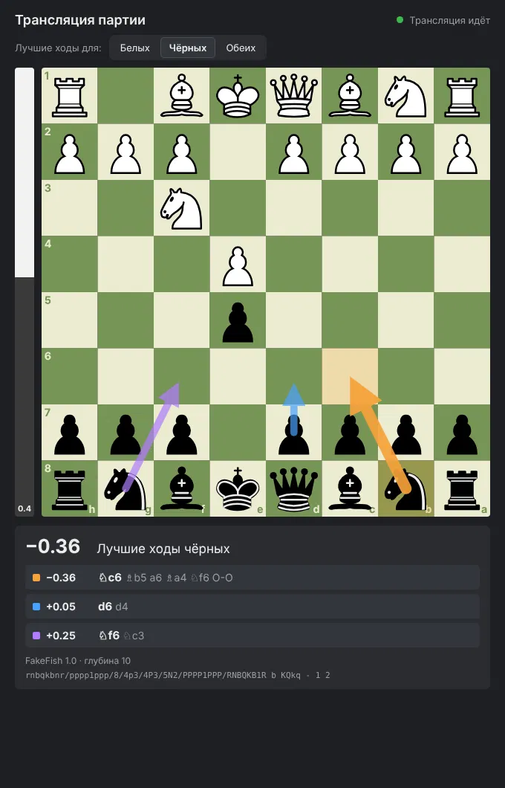
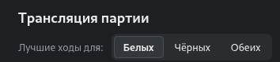

# Fake Broadcast — «Фальшивая трансляция»


Открываешь партию на chess.com, а на соседней вкладке (или на телефоне) видишь ту же
доску, где Stockfish стрелками подсказывает лучшие ходы, показывает, кто сейчас
выигрывает, и что будет дальше.

Выглядит как обычная трансляция для зрителей. Но проект показывает простую вещь:
сайт никак не может узнать, что рядом с игроком работает такая программа.



> ⚠️ В партиях против живых людей трансляция идёт с задержкой 3 минуты, как на турнирных
> трансляциях с движком. Без задержки она работает только в игре с компьютером и в анализе.
> Подсказки движка в партиях с людьми запрещены правилами chess.com, за это банят.

---

## 1. Как запустить

Понадобятся Linux, Google Chrome и Docker (или Python).

**Шаг 1. Запустите Chrome в особом режиме.** Так программа сможет видеть, что на странице.

```bash
pkill chrome; google-chrome --remote-debugging-port=9222 --user-data-dir=/tmp/chrome-debug &
```

Откроется чистый Chrome без ваших вкладок, так и должно быть. Войдите в нём на chess.com
и начните игру с компьютером.

**Шаг 2. Запустите программу.**

```bash
docker compose up --build
```

Первый запуск займёт пару минут (скачивается Stockfish), потом всё стартует за секунды.

Без Docker:

```bash
./get_stockfish.sh
pip install flask
python3 app.py
```

**Шаг 3. Откройте http://localhost:5000** — готово.


### Что на экране

- 🟠 **Оранжевая стрелка** — лучший ход
- 🔵 **Синяя** — второй вариант
- 🟣 **Фиолетовая** — третий
- 🔴 **Красная пунктирная** — ваш лучший ответ, пока думает соперник
- **Шкала слева** — кто выигрывает. Число со стороны белых: `+1.50` — белые лучше,
  `−1.50` — чёрные, `#3` — мат в 3 хода

Сверху можно выбрать, чьи ходы подсказывать: белых, чёрных или обеих сторон.



### Если что-то не работает

| Что видите | Что сделать |
|---|---|
| «Chrome не отвечает» | Закройте Chrome полностью и запустите командой из шага 1 |
| «Нет вкладки с chess.com» | Откройте партию в том окне Chrome, которое открылось на шаге 1 |
| «Stockfish не найден» | Запустите `./get_stockfish.sh` |
| Внизу «позиция: приблизительно» | chess.com что-то поменял, напишите в Issues |

---

## 2. Как это нашёл

Никакого взлома тут нет. Я просто посмотрел, что и так лежит на виду.

**Доска на chess.com — это обычная веб-страница.** Каждая фигура на ней — элемент
с понятным названием, например «белая пешка на e2». А у самой доски есть встроенная
функция, которая отдаёт позицию целиком, вместе с тем, чей ход и можно ли рокироваться.

**Chrome умеет пускать к себе программы.** Если запустить его с отладочным портом,
внешняя программа может прочитать любую открытую вкладку. Это функция для разработчиков,
она есть в каждом Chrome. Расширения не нужны, страница игры не меняется, а сайт ничего
не замечает.

**Подсказки показываются отдельно.** Стрелки рисуются не поверх chess.com, а на своей
странице. Её можно открыть на втором мониторе или на телефоне, и на экране игры не будет
никаких следов.

<!-- 📷 ФОТО 4 (по желанию): DevTools Chrome, где виден элемент фигуры с классами
     вроде «piece wp square-52». Положите файл рядом с README и раскомментируйте строку:

-->


**Главный вывод.** Чтобы показать игроку доску, сайт обязан отправить позицию ему
на компьютер. А всё, что попало на компьютер игрока, он может прочитать. Задержка
в этой программе тоже работает на компьютере игрока, поэтому полагаться на неё нельзя.
Так что защита возможна только на стороне сервера.

---

## 3. Что с этим делать разработчикам шахматных сайтов

Запретить читать позицию нельзя. Зато можно сделать так, чтобы подсказки движка
было легко заметить.

**Смотреть на то, как человек играет.** Сервер видит все ходы, этого достаточно:

- **Слишком точная игра.** Если ходы почти всегда совпадают с лучшими ходами движка,
  а рейтинг у игрока средний — это подозрительно.
- **Странное время на ход.** Человек быстро делает простые ходы и долго думает над
  сложными. С подсказками время на ход часто одинаковое, что бы ни было на доске.
- **Резкий рост.** Новый аккаунт, который вдруг выигрывает всё подряд.
- **Выводы по многим партиям.** Одна отличная партия ничего не значит,
  сотни ходов на уровне движка — уже значат.
- **Окончательное решение принимает человек.** Автоматика находит подозрительных,
  а банит специалист. Так меньше ошибок.

**Мелочи на стороне сайта.** Сами по себе они не защитят, но усложнят жизнь
и добавят сигналов для проверки:

- не держать функцию, которая отдаёт всю позицию, в открытом доступе;
- замечать, когда игрок во время своего хода уходит с вкладки.

Запутывать код страницы почти бесполезно: позицию можно распознать даже со скриншота.

**Для трансляций.** Если стример показывает оценку движка, задержку должен ставить
сервер, а не программа у стримера.

**И просто по-человечески:** понятные правила, программа вознаграждения за найденные
уязвимости, возврат рейтинга тем, кто проиграл нарушителю.

---

## Стек

| | Технология | Зачем |
|---|---|---|
| 🐍 | **Python 3.11 + Flask** | сервер: отдаёт страницу трансляции и данные о позиции |
| 🔌 | **Chrome DevTools Protocol** | читает позицию с вкладки chess.com. Свой маленький WebSocket-клиент, без Selenium и chromedriver |
| ♟️ | **Stockfish 18** | ищет лучшие ходы по протоколу UCI, сразу три варианта (MultiPV) |
| 🎨 | **JavaScript + SVG** | доска, стрелки и шкала оценки нарисованы вручную, без сторонних библиотек |
| 🖼️ | **Фигуры cburnett** | классический набор фигур, как на Википедии и lichess |
| 🐳 | **Docker Compose** | запуск одной командой, Stockfish скачивается в образ сам |

Из зависимостей только Flask. Всё остальное — стандартная библиотека Python и браузер.

```
chess.com в Chrome ──DevTools──▶ app.py ──UCI──▶ Stockfish
                                    │
                                    ▼
                    http://localhost:5000 (доска со стрелками)
```

---

## Настройки

Все настройки — в `docker-compose.yml`. Менять их не обязательно.

| Настройка | По умолчанию | Зачем |
|---|---|---|
| `ENGINE_DEPTH` | `30` | насколько глубоко думает Stockfish (больше — сильнее, но дольше) |
| `ENGINE_LINES` | `3` | сколько вариантов показывать |
| `ENGINE_THREADS` | все ядра − 1 | сколько ядер процессора отдать движку |
| `ENGINE_HASH` | `512` | память движка, МБ |
| `LIVE_DELAY` | `180` | задержка в партиях с людьми, сек (минимум 60) |
| `REMOTE_DEBUGGER` | `127.0.0.1:9222` | где искать Chrome |

---

## Лицензия и правила

Проект сделан, чтобы показать проблему и способы защиты от неё. Не используйте его,
чтобы получать подсказки в партиях против живых людей: это нечестно по отношению
к сопернику, нарушает правила chess.com и ведёт к блокировке аккаунта.

<!-- Здесь можно указать лицензию самого проекта, например MIT или GPLv3.
     Stockfish распространяется по GPLv3, поэтому GPLv3 будет самым простым вариантом. -->

Фигуры: набор cburnett (Colin M.L. Burnett), GPLv2+, см. `static/pieces/LICENSE.txt`.
Движок: [Stockfish](https://stockfishchess.org), GPLv3.